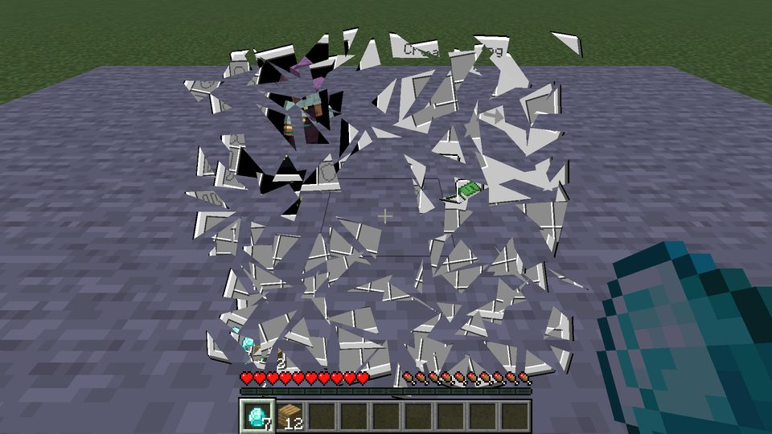
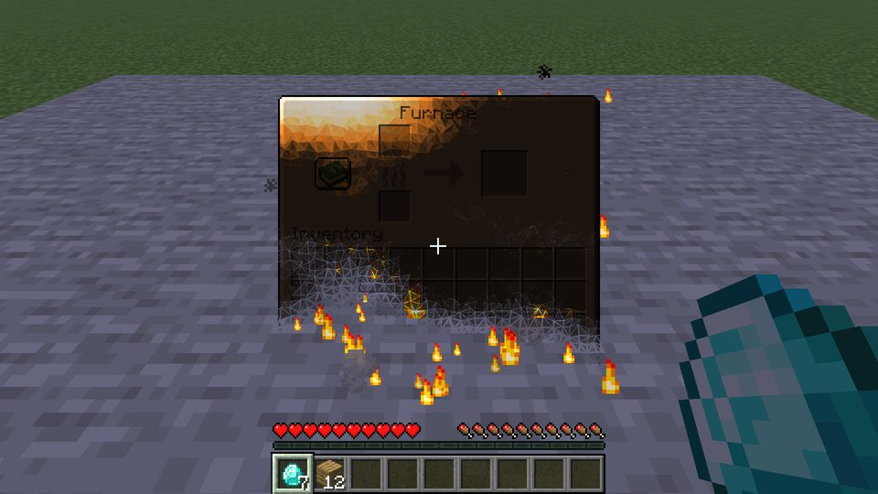
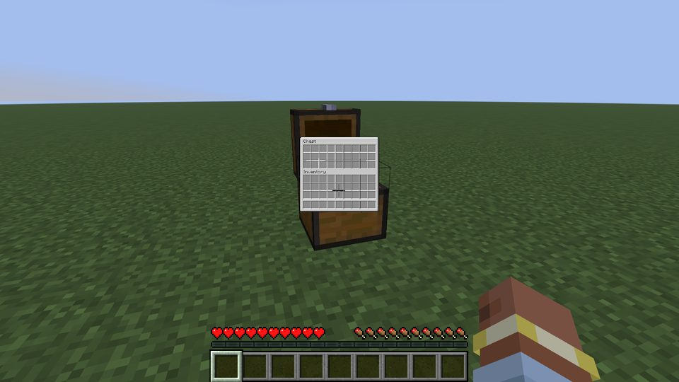
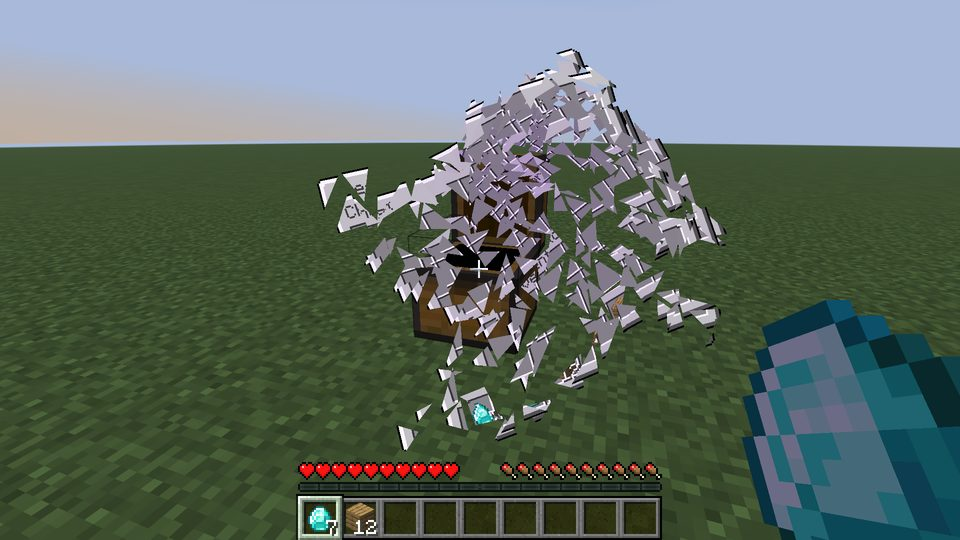
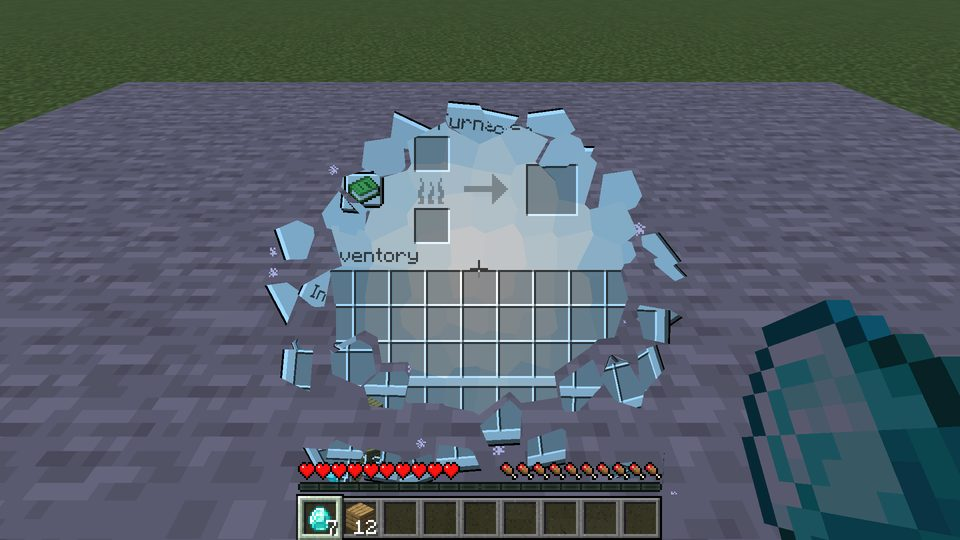
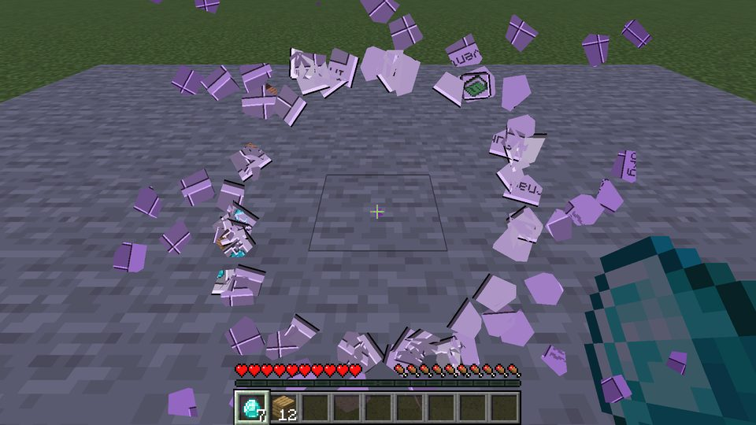
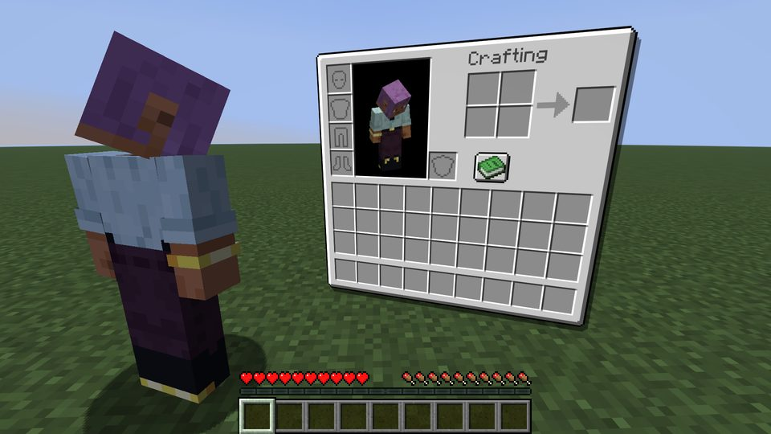
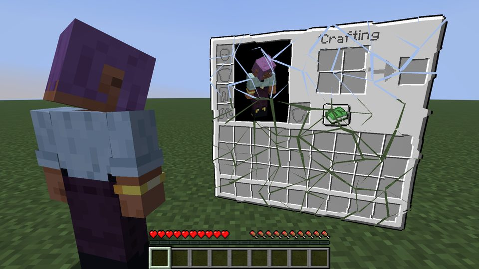
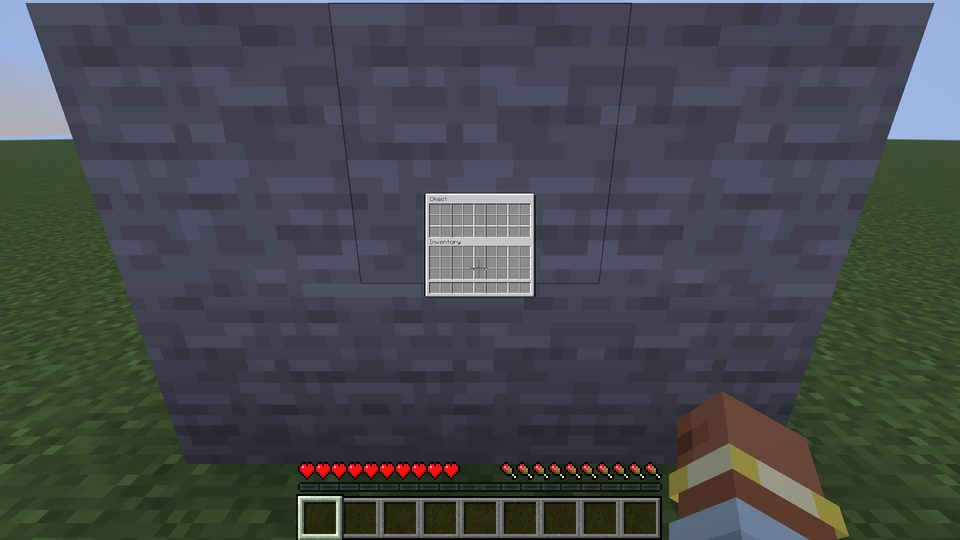
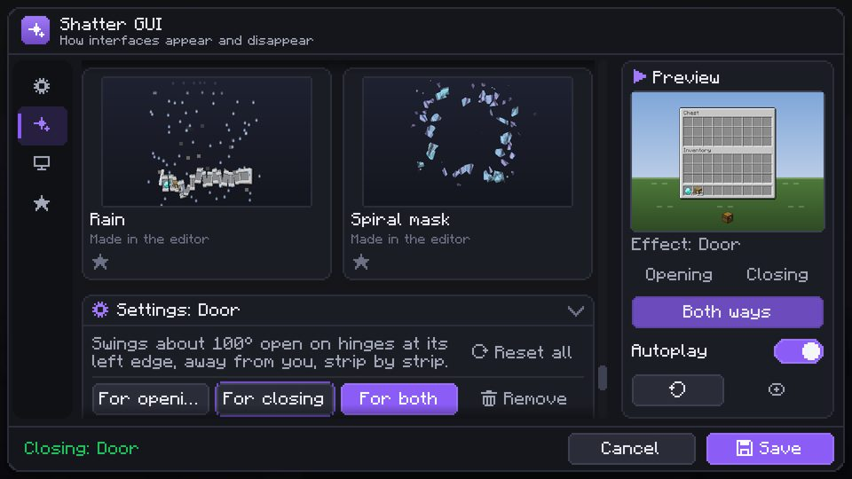

# Shatter GUI

A client-side Fabric mod for Minecraft 26.1.x, 26.2 and 26.3. When you close an interface (chest, furnace, inventory, pause menu…)
its last frame breaks into pieces that live in the world: glass shards, fire, ice, sand, confetti, a portal vortex…
Effects can also play backwards when you open an interface, so it gathers from its pieces.

- Client only, no server needed, no real entities.
- 5 built-in effects (glass, burn, fly back into the block, dissolve, vortex) and 27 shipped data effects:
  frost, sand, ender portal, runes, lightning, glitch, paper plane, tiles, explosion, confetti, bubbles, soul fire,
  pixelate, blinds, and 13 quick light ones (0.45–0.9 s, at most 60 pieces): pop, slide, card flip, recede, door,
  ripple, twirl, drop, accordion, sticker, spring, tear, iris. All of them, and glass, burn ("rises from embers"),
  dissolve and vortex, also work for opening: the interface gathers from its pieces, with or without Spatial GUI.
- Visual effect editor with live preview, timeline, curves, textures, particles and sounds.
- Thematic mode (off by default): furnaces burn, enchanting tables break into runes, ender chests vanish into a
  portal… The table is editable in the Screens tab.
- Works with Spatial GUI (shatters its 3D plane) and Iris shader packs. Mod Menu adds a config button.
- Accessibility: "Reduce motion" (calmer versions, no flicker), at most 3 flashes per second.

## Screenshots

Taken by the automated game tests (Minecraft 26.1.2, no shader pack unless noted).

| | |
|---|---|
|  Glass |  Burn |
|  Fly back into the chest |  Vortex |
|  Frost |  Ender portal |
|  Spatial GUI's plane… |  …breaks in place |
|  Flying through a wall, drawn over blocks |  Effects tab |

More in `docs/screenshots/`: dissolve, runes, lightning, paper plane, explosion, confetti, soul fire, pixelate, card flip,
door, pieces bouncing off blocks, the same flight with "Draw over blocks" off, the fly-out, the General tab and the
effect editor.

## Requirements

Minecraft 26.1, 26.1.1 or 26.1.2 (one jar, `+mc26.1`), 26.2 (`+mc26.2`) or 26.3 (`+mc26.3`), on OpenGL or Vulkan. Fabric Loader ≥ 0.19.3, Fabric API, Java 25. Optional: Mod Menu, Spatial GUI, Iris + Sodium (Spatial GUI 1.10, and Iris on 26.3, need a Fabric Loader newer than 0.19.3; 0.20.1 works).

## Configuration

In game: Mod Menu → Shatter GUI, or the "Shatter GUI settings" key. Tabs: General (open/close effect, thematic mode,
style, playback, performance — effect quality and how many effects play at once —, reduce motion), Effects (settings per effect; under the selected card "For opening / For closing /
For both / Remove", a double click uses a card for both, ★ marks favourites), Screens (per-screen effects, thematic
table), Custom (effect editor). The "Next favourite close effect" key (unbound by default) switches between the
favourites. Pieces in flight are drawn over the world by default ("Draw over blocks"): blocks in front never cut into
them; a piece that has settled on the ground is hidden by blocks like the rest of the world. The player's hand, the HUD
and screens stay on top. The config is `config/shatter_gui.json`.

**Page status in About.** By each page button a dot says whether the page is up: green (yes), yellow (not published yet
or in moderation; the button explains before opening the link), grey (could not check). To know this the mod asks
`api.modrinth.com` and `api.github.com` once per session, only while the About section is open, off the game's thread,
for 3 seconds at most, with the User-Agent `lilaktt/shatter-gui/<version>` and nothing else. CurseForge has no public
API without a key and is not checked. It never blocks the game and does nothing without a network. Turn it off with
"Check the mod's pages" (`"linkStatusCheck": false`).

## Custom effects

Effects are JSON files (schema 2) in `config/shatter_gui/effects/`, packages (`.shatterfx`, a ZIP with
`effect.json` and `textures/*.png`) in `config/shatter_gui/packages/`, or `assets/<ns>/shatter_gui/effects/` in a
resource pack. The format is described in `docs/EFFECT_FORMAT.md`. The easiest start: open a shipped effect with
"Copy to my effects" and change it in the editor.

## Languages

English (source of truth) and Ukrainian are written by hand. German, Spanish, French, Brazilian Portuguese, Polish,
Simplified Chinese, Russian, Japanese, Korean and Italian are **machine translations** and need review by native
speakers. Missing keys fall back to English.

To send a correction: change `core/src/main/resources/assets/shatter_gui/lang/<code>.json` and open a pull request on the
mod's source page, or open an issue with the key, the current text and your text. Keep the terms of
`docs/i18n/GLOSSARY.md` and every `%s`/`%d`; `./gradlew test` checks keys and placeholders. The same note is in
the mod: General tab → About.

## Known limitations

- While the darkened world behind a closed interface fades out, the hotbar is not darkened (it stays over the close
  effect, as before), so it brightens at once when the close starts. The menu blur fades in steps of one pixel.
- With "Draw over blocks" switched off and a shader pack, a close is drawn over the world while the darkened background
  fades (about 0.5 s) and in the world after that, where the pack lights and colours it: its colour changes at that
  moment. Openings are always drawn over the world, unlit, like the interface they become.
- Minecraft 26.3 on Vulkan sometimes crashes (`0xC0000005`, no `hs_err` file) while it loads resources at start, before
  the title screen, with or without the mod: on an NVIDIA RTX 3050 with driver 610.62, 3 of 20 starts with the mod and 2
  of 20 without it (Fabric API only), at the same moment. It is not caused by the mod; start the game again or use
  OpenGL.
- Validation messages of the effect format (with JSON paths) are in English.
- "Darken" overlays are drawn as normal blending with shader packs.
- With a shader pack, the pieces in flight are also drawn over the player's hand (the pack draws the hand inside its
  own pass); settled pieces are under it.

## Building

```
./gradlew build                 # build/libs/shatter-gui-<version>+mc26.1-fabric.jar, runs unit tests
./gradlew build -Pmc=26.2       # the same for 26.2 (or 26.3)
./gradlew runClientGameTest     # automated tests in a real client (screenshots in platform-26/build/run/clientGameTest)
./gradlew runClientGameTest -PspatialGui=1.10.1 -PmodMenu
./gradlew runClientGameTest -Pshaders -PshaderPack=C:/path/to/Pack.zip
./gradlew runClientGameTest -PtestOnly=lang -Plang=ja_jp   # one language at GUI scales 1–4, screenshots lang_ja_…
./gradlew build -Pmc=1.21.1     # the 1.21.1 port (a stub so far)
./gradlew runVersionMatrix --no-daemon -PshaderPack=C:/path/to/Pack.zip   # a short test set on every version, for the night
```

The shared code (`core`, no Minecraft; `platform-26-shared`, all of 26.x) and one module per Minecraft version
(`platform-*`) are described in `docs/PORTING.md`, the versions in `docs/VERSIONS.md`, the last results in
`docs/TEST_MATRIX.md`.

Author and links are in `gradle.properties` (`mod_author`, `mod_sources`, `mod_issues`, `mod_modrinth`,
`mod_curseforge`).

## Links

- Modrinth: https://modrinth.com/mod/shattergui
- CurseForge: https://www.curseforge.com/minecraft/mc-mods/shattergui
- GitHub: https://github.com/lilaktt/shatter-gui
- Bug reports: https://github.com/lilaktt/shatter-gui/issues

The names and logos of Modrinth, CurseForge and GitHub belong to their owners. The mod ships no logos: the page buttons
show simple icons of its own, or pictures put into `assets/shatter_gui/textures/gui/links/` (`modrinth.png`,
`curseforge.png`, `github.png`, `bug.png`, 16×16, and `_32` versions at 32×32 for large GUI scales), which need no code
change.

## Author

lilaktt.

## License

Apache License 2.0, see `LICENSE` and `NOTICE` (Copyright 2026 lilaktt). Third-party notes: `THIRD_PARTY.md` —
the idea was inspired by Spatial GUI by tastytrash (MIT); no code from it is included.
