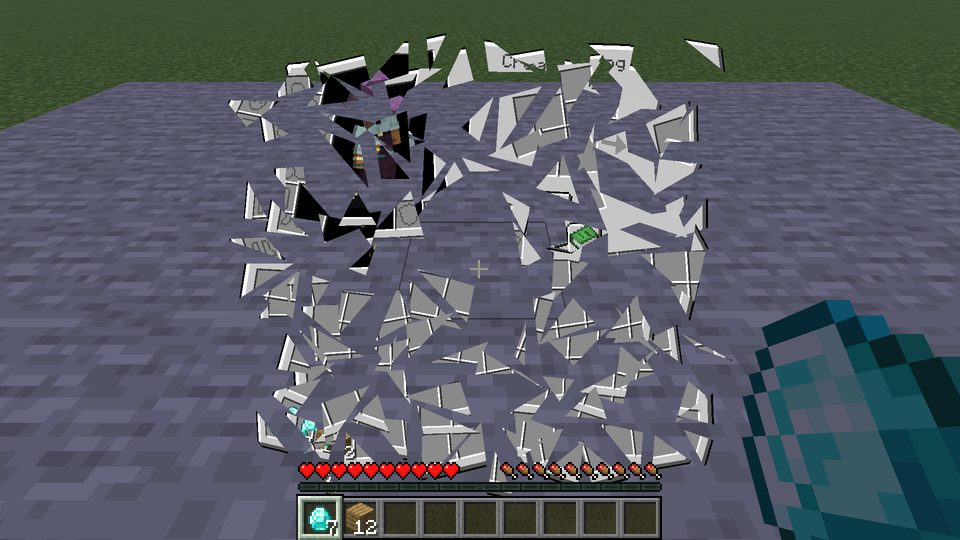
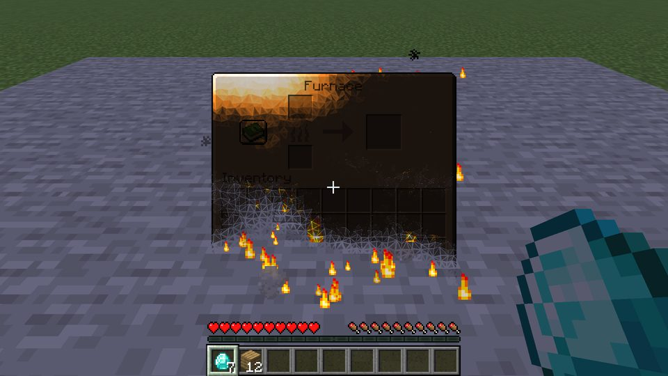
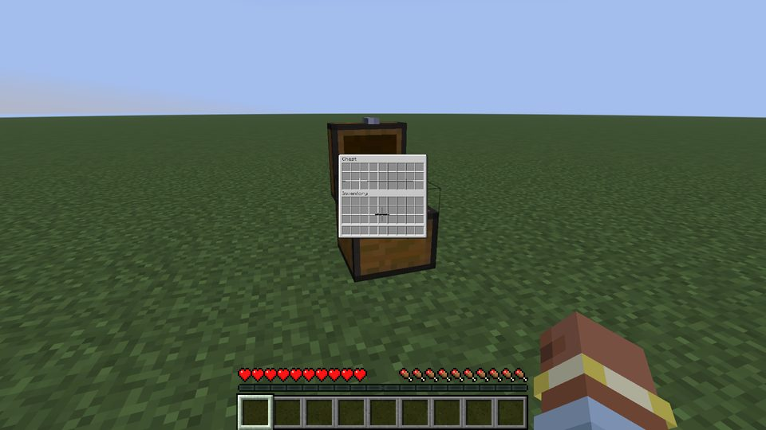
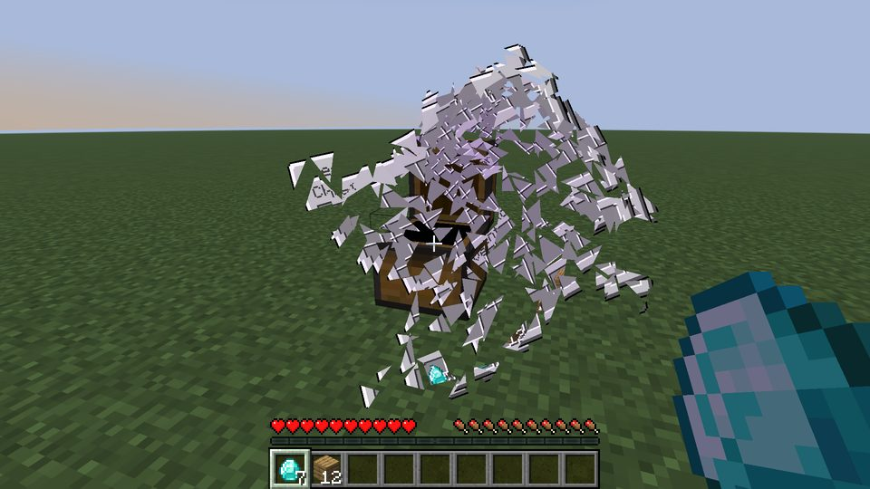
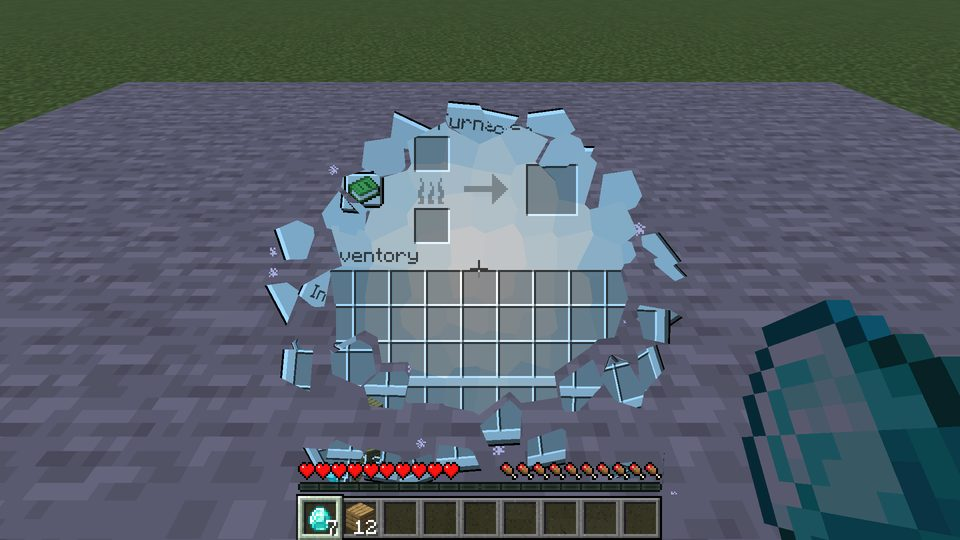
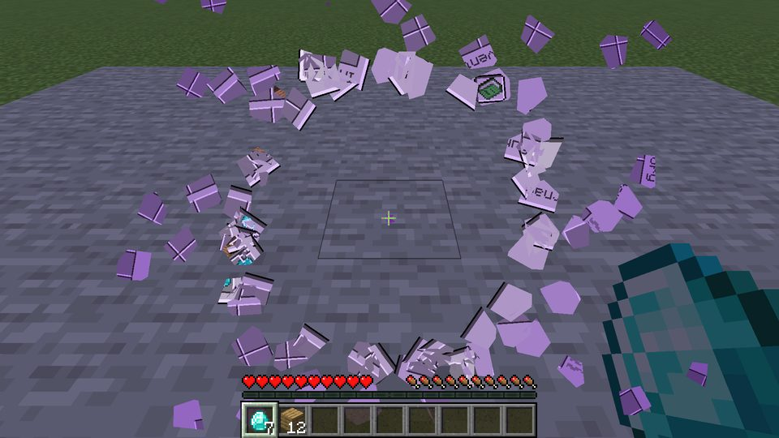
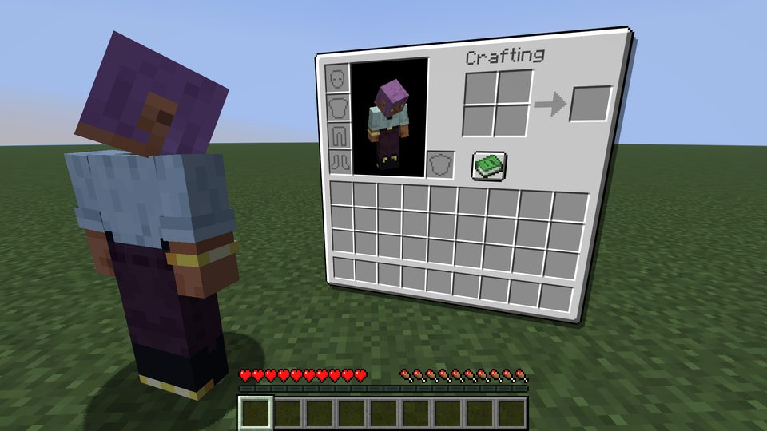
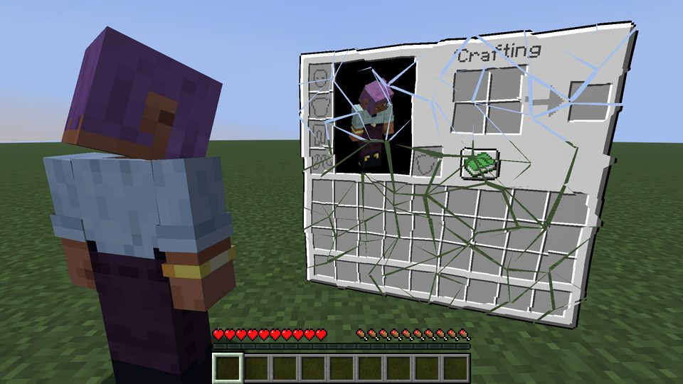
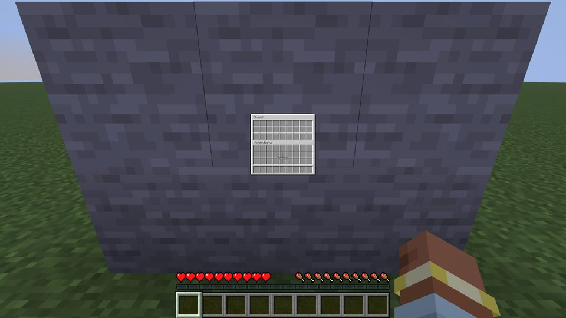
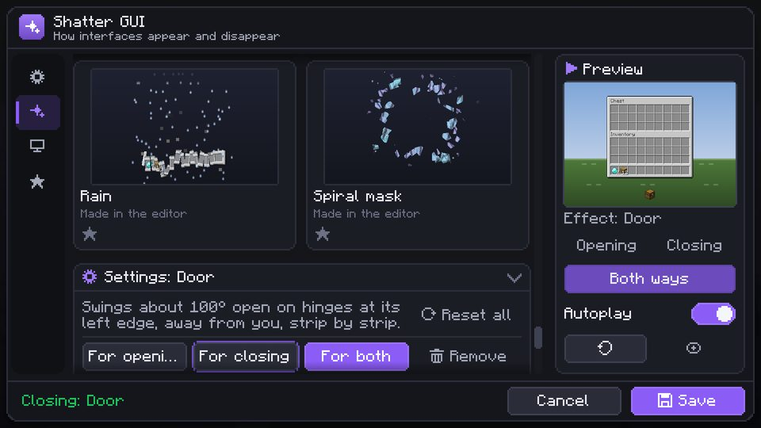

# Shatter GUI

A client-side Fabric mod for Minecraft 26.1.2. When you close an interface (chest, furnace, inventory, pause menu…)
its last frame breaks into pieces that live in the world: glass shards, fire, ice, sand, confetti, a portal vortex…
Effects can also play backwards when you open an interface, so it gathers from its pieces.

- Client only, no server needed, no real entities.
- 5 built-in effects (glass, burn, fly back into the block, dissolve, vortex) and 27 shipped data effects:
  frost, sand, ender portal, runes, lightning, glitch, paper plane, tiles, explosion, confetti, bubbles, soul fire,
  pixelate, blinds, and 13 quick light ones (0.45–0.9 s, at most 60 pieces): pop, slide, card flip, recede, door,
  ripple, twirl, drop, accordion, sticker, spring, tear, iris. All of them, and glass, burn ("rises from embers"),
  dissolve and vortex, also work for opening: the interface gathers from its pieces, with or without Spatial GUI.
- Visual effect editor with live preview, timeline, curves, textures, particles and sounds.
- Thematic mode (off by default): furnaces burn, enchanting tables break into runes, ender chests vanish into a
  portal… The table is editable in the Screens tab.
- Works with Spatial GUI (shatters its 3D plane) and Iris shader packs. Mod Menu adds a config button.
- Accessibility: "Reduce motion" (calmer versions, no flicker), at most 3 flashes per second.

## Screenshots

Taken by the automated game tests (Minecraft 26.1.2, no shader pack unless noted).

| | |
|---|---|
|  Glass |  Burn |
|  Fly back into the chest |  Vortex |
|  Frost |  Ender portal |
|  Spatial GUI's plane… |  …breaks in place |
|  Flying through a wall, drawn over blocks |  Effects tab |

More in `docs/screenshots/`: dissolve, runes, lightning, paper plane, explosion, confetti, soul fire, pixelate, card flip,
door, pieces bouncing off blocks, the same flight with "Draw over blocks" off, the fly-out, the General tab and the
effect editor.

## Requirements

Minecraft 26.1.2, Fabric Loader ≥ 0.19.3, Fabric API, Java 25. Optional: Mod Menu, Spatial GUI, Iris + Sodium.

## Configuration

In game: Mod Menu → Shatter GUI, or the "Shatter GUI settings" key. Tabs: General (open/close effect, thematic mode,
style, playback, performance — effect quality and how many effects play at once —, reduce motion), Effects (settings per effect; under the selected card "For opening / For closing /
For both / Remove", a double click uses a card for both, ★ marks favourites), Screens (per-screen effects, thematic
table), Custom (effect editor). The "Next favourite close effect" key (unbound by default) switches between the
favourites. Effects are drawn over the world by default ("Draw over blocks"): blocks in front never cut into them,
the player's hand, the HUD and screens stay on top. The config is `config/shatter_gui.json`.

## Custom effects

Effects are JSON files (schema 2) in `config/shatter_gui/effects/`, packages (`.shatterfx`, a ZIP with
`effect.json` and `textures/*.png`) in `config/shatter_gui/packages/`, or `assets/<ns>/shatter_gui/effects/` in a
resource pack. The format is described in `docs/EFFECT_FORMAT.md`. The easiest start: open a shipped effect with
"Copy to my effects" and change it in the editor.

## Languages

English (source of truth) and Ukrainian are written by hand. German, Spanish, French, Brazilian Portuguese, Polish,
Simplified Chinese, Russian, Japanese, Korean and Italian are **machine translations** and need review by native
speakers. Missing keys fall back to English.

To send a correction: change `src/main/resources/assets/shatter_gui/lang/<code>.json` and open a pull request on the
mod's source page, or open an issue with the key, the current text and your text. Keep the terms of
`docs/i18n/GLOSSARY.md` and every `%s`/`%d`; `./gradlew test` checks keys and placeholders. The same note is in
the mod: General tab → About.

## Known limitations

- When an interface opens by gathering, the darkened/blurred world behind it appears together with the interface
  at the end (as it disappears at once on closing).
- With "Draw over blocks" switched off and a shader pack, the pieces are lit and coloured by the pack (they are in the
  world), the interface that replaces them is not: its colour changes when it appears.
- Validation messages of the effect format (with JSON paths) are in English.
- "Darken" overlays are drawn as normal blending with shader packs.
- With a shader pack, the pieces drawn over blocks are also drawn over the player's hand (the pack draws the hand
  inside its own pass).

## Building

```
./gradlew build                 # build/libs/shatter-gui-<version>.jar, runs unit tests
./gradlew runClientGameTest     # automated tests in a real client (screenshots in build/run/clientGameTest)
./gradlew runClientGameTest -PspatialGui=1.8 -PmodMenu
./gradlew runClientGameTest -Pshaders -PshaderPack=C:/path/to/Pack.zip
./gradlew runClientGameTest -PtestOnly=lang -Plang=ja_jp   # one language at GUI scales 1–4, screenshots lang_ja_…
```

Author and links are in `gradle.properties` (`mod_author`, `mod_sources`, `mod_issues`, `mod_modrinth`,
`mod_curseforge`).

## Links

- Modrinth: https://modrinth.com/mod/shattergui
- CurseForge: https://www.curseforge.com/minecraft/mc-mods/shattergui
- GitHub: https://github.com/lilaktt/shatter-gui
- Bug reports: https://github.com/lilaktt/shatter-gui/issues

## Author

lilaktt.

## License

Apache License 2.0, see `LICENSE` and `NOTICE` (Copyright 2026 lilaktt). Third-party notes: `THIRD_PARTY.md` —
the idea was inspired by Spatial GUI by tastytrash (MIT); no code from it is included.
